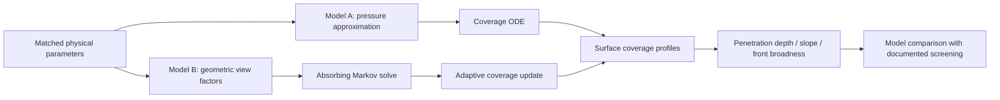

# ALD conformality: a two-model MATLAB reproduction

**Diffusion–reaction and ballistic transport–reaction models for lateral high-aspect-ratio channels.**

This repository organizes an independent reproduction of Järvilehto *et al.*, **“Simulation of conformality of ALD growth inside lateral channels: comparison between a diffusion–reaction model and a ballistic transport–reaction model”**, *Physical Chemistry Chemical Physics* **25**, 22952–22964 (2023). [Paper · DOI 10.1039/D3CP01829F](https://doi.org/10.1039/D3CP01829F)

It preserves **21 original MATLAB source files**, archives recoverable historical results, and adds a portable runner, figure exports, provenance records, and small-system checks. The release keeps the existing physical model and numerical settings intact.

[中文技术文档](docs/zh/index.md) · [Data provenance](data/historical/sources.json) · [Validation record](docs/validation/release-checks.md) · [Third-party notices](THIRD_PARTY_NOTICES.md)

## Research question

How does the transport model change the predicted surface coverage inside an ALD microchannel, even when nominal process conditions are matched?

| | Model A: diffusion–reaction | Model B: ballistic transport–reaction |
|---|---|---|
| Transport | Piecewise analytical approximation of the pressure field | Geometry-based view factors and an absorbing Markov chain |
| Surface evolution | Langmuir adsorption/desorption, integrated with `ode23` | Irreversible adsorption, adaptive implicit coverage updates |
| Channel end | End-wall interactions are omitted | Closed end wall is an explicit reacting segment |
| Implementation | Pressure-history approximation inherited from DReaM-ALD | Dense reference for small geometries; matrix-free FFT/Toeplitz products and BiCGSTAB for large geometries |

The comparison is restricted to free molecular transport (Knudsen number much larger than one), where Model B's ballistic assumption applies. The paper's parameter selection is motivated by TMA–water alumina ALD; this repository studies the stated generic parameter set and a single exposure.

Model B solves probability equations deterministically. It does not draw random particle trajectories or sample Gillespie events.



## Recoverable historical results


**Historical parity comparison — Cases I–VII.** Each marker represents a paired condition retained by both implementations. Model B is on the horizontal axis, Model A on the vertical axis; the dashed line indicates equality. The figure is redrawn from printed historical metrics, with their recorded precision, and can be regenerated without a simulation.

| Metric | Paired conditions | Mean ratio from archived point data |
|---|---:|---:|
| Half-coverage penetration depth, B/A | 26 | **1.4858** (+48.58%) |
| Absolute half-coverage slope, A/B | 26 | **1.9895** |
| Adsorption-front broadness, B/A | 24 | **2.7565** |

These are pooled means of per-condition ratios; repeated baseline conditions remain in their original parameter series. They are not ratios of pooled metric means.

The original eight-case report recorded **31/31/29** pairs and summary ratios of **1.4867/1.9657/2.6226**. Case VIII's individual Model A slope and broadness values were not retained in the accessible log, so the full slope and broadness summaries cannot currently be independently recomputed. They remain labelled **reported historical aggregates**, separate from the auditable seven-case figure. [Result details](docs/zh/results.md) · [CSV](data/historical/metrics.csv) · [Summary JSON](data/historical/historical_summary.json)

Historical data, paper-reported findings, and newly executed checks are separate evidence classes. No full-scale simulation was rerun to produce this release's figure.

## Quick start

Open MATLAB in the repository root:

```matlab
addpath(pwd);
ald_repro;                           % list tasks and output options
ald_repro('smoke');                  % small-system checks
ald_repro('replot-historical');      % regenerate the archived parity figure
```

Or use a terminal from the repository root:

```sh
matlab -batch "addpath(pwd); ald_repro('smoke'); ald_repro('replot-historical');"
python checks/validate_repository.py
```

The Python archive checker uses the standard library only. It checks sources, data, statistics, and local Markdown links; it does not run a scientific simulation.

**Environment:** MATLAB **R2025b** was used for release checks. The wrapper targets **R2020a or newer**; other releases have not been tested. The original solvers use base MATLAB functionality. MATLAB requires its own installation and license.

### Available tasks

| Task | Action | Evidence produced |
|---|---|---|
| `help` | Show the interface; also the default task | No simulation |
| `smoke` | Check small-system geometry, probability closure, FFT agreement and coverage limits | Fresh check report |
| `replot-historical` | Read archived Cases I–VII metrics and redraw the figure | Historical-data visualization |
| `baseline-a` | Call the original Model A baseline function | Fresh Model A run |
| `baseline-b` | Call the original Model B baseline function | Fresh Model B run |
| `scan-a` | Run the original eight-series Model A script, including its appended sensitivity calculations | Fresh Model A scan |
| `scan-b` | Run the original eight-series Model B script | Fresh Model B scan |
| `compare-historical` | Recompute A and compare against the original hard-coded B metrics | Mixed fresh-A / historical-B comparison |

Full scans are explicit tasks and may take substantial time, especially at high sticking probability. Their presence is not a claim that every case has passed numerical validation.

Output options affect recording and figure visibility only:

```matlab
opts = struct('OutputDir', fullfile(pwd, 'results', 'my-run'), ...
              'ExportFigures', true, 'FigureVisible', 'off');
ald_repro('replot-historical', opts);
```

New runs write separate output directories containing a manifest, logs, MAT results, CSV metrics, and exported figures as applicable. Generated runs are ignored by Git. The scientific settings continue to come from the preserved sources.

## Parameter-series coverage

Both original scan scripts define the eight series in the paper's Table 2. Weekly reports recorded completion of these series. Recoverable numerical records are more limited than those completion reports.

| Case | Varied parameter | Values |
|---|---|---|
| I | Temperature, K | 373.15, 473.15, 573.15, 673.15, 773.15 |
| II | Inlet precursor partial pressure, Pa | 1, 2.5, 5, 10, 20 |
| III | Reactant molar mass, kg/mol | 0.05, 0.1, 0.15, 0.2, 0.25 |
| IV | Channel height, µm; corresponding aspect ratio | 0.125, 0.25, 0.5, 1, 2; AR = 4000, 2000, 1000, 500, 250 |
| V | Exposure time, s | 0.01, 0.1, 1, 10, 100 |
| VI | Sticking/reaction probability | 1, 0.1, 0.01, 0.001, 0.0001, 0.00001 |
| VII | Adsorption capacity / site area | q = 0.5, 1, 2, 4, 8 nm⁻²; s₀ = 2, 1, 0.5, 0.25, 0.125 nm² |
| VIII | Constant exposure, 10 Pa·s | (p, t) = (0.08, 125), (0.4, 25), (2, 5), (10, 1), (50, 0.2) |

Figures 3–5 motivate the profile and metric scans; Figure 6 motivates the parity comparison. The existing resolution checks cover a subset of Figure 2's conditions. Figure 7 explains geometric effects; this release does not claim a complete regeneration of every paper figure. [Parameters and units](docs/zh/parameters.md) · [Equation/code/figure map](docs/zh/traceability.md)

## Numerical choices and limitations

The original implementation is preserved so that historical results remain traceable:

- **Model A:** persistent pressure history is inherited from DReaM-ALD v1.0.0; the preceding RHS evaluation need not be the preceding accepted time step. Integration starts at 0.001 s with zero coverage. The current `ode23` call uses different tolerance settings from the upstream script.
- **Screening:** A uses entrance coverage ≥0.999; B uses first-wall-segment coverage ≥0.995. The paper does not specify these numerical thresholds, and the sampled positions differ.
- **High-reactivity B runs:** the scan uses `ep=2` for β₀=1 and `ep=0.2` for β₀=0.1, compared with the ordinary `ep=0.05`. Existing coarse-step comparisons do not establish fine-step convergence.
- **Iterative solve:** the original B solver warns on BiCGSTAB failure and may continue with the approximate solution. A prior long-channel, fully covered check exposed this limitation. New logs retain warnings; the wrapper does not change the solver.
- **Metrics:** half coverage is interpolated between two adjacent points; broadness uses the first discrete points below 0.9 and 0.1. Model B's end-wall trunk can make the profile nonmonotonic.
- **Evidence:** raw historical saturation-profile arrays and complete Case VIII A metrics were not retained. Original scientific screenshots are preserved as historical evidence; no numerical curves are reconstructed from their pixels.

[Detailed numerical audit](docs/zh/numerics.md) · [Known differences](docs/zh/results.md) · [History coverage](docs/validation/history-coverage.md)

The model output is fractional surface coverage for the studied exposure. It is not a calibrated multi-cycle film-thickness or IGZO growth prediction. [Physical and process interpretation](docs/zh/physics.md)

## Repository map

```text
ald_repro.m                 portable public entry point
+aldrepro/                  recording, plotting and check helpers
src/ModelA_Reproduction/    9 preserved original MATLAB files
src/ModelB_Reproduction/    12 preserved original MATLAB files
data/historical/            recoverable metrics and provenance
data/source_manifest.json   hashes of all preserved sources
docs/zh/                    Chinese technical documentation
docs/assets/                reproducible figure and historical screenshots
docs/validation/            coverage and release-check records
checks/                     MATLAB smoke and Python archive checks
licenses/                   upstream license texts
```

## Citation and attribution

Please cite the original paper when using the models or their scientific conclusions. Cite DReaM-ALD and Machball for the inherited implementations. [Bibliography](references.bib) · [Software citation metadata](CITATION.cff)

This reproduction is maintained by **Zihao Bai (白子豪)**. New packaging code is provided under the [MIT License](LICENSE). Inherited or adapted components retain the DReaM-ALD MIT and Machball BSD-style terms documented in [THIRD_PARTY_NOTICES.md](THIRD_PARTY_NOTICES.md). Author credit for the original models remains with their respective authors.

## Future work

Future validation can address accepted-step pressure history in A, rejected iterative solves in B, decreasing-`ep` convergence studies, and persistent raw output for all cases. Those changes would require separate numerical comparisons against this preserved implementation.

[Contributing](CONTRIBUTING.md) · [Release notes](CHANGELOG.md) · [GitHub upload guide / 上传说明](docs/github-upload.zh.md)
