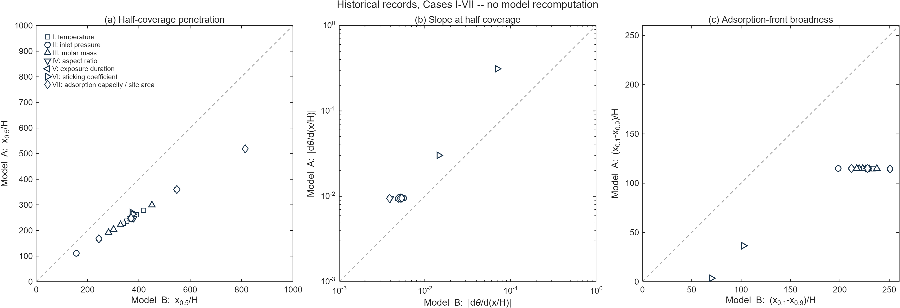

# 已有复现结果、统计口径与模型差异

本工程已有八组参数扫描的源代码、历史运行记录和汇报结果图。此次发布整理这些成果，不重新执行完整扫描。最重要的区分是：**报告完成范围是八组，能够用留存逐点表直接重画的完整 parity 范围是 I–VII**。Case VIII 的部分 A 指标没有留存，缺失值不能由汇总统计反推。

## 三类结果证据

| 类型 | 数据来源 | 可以支持的判断 |
|---|---|---|
| 论文结果 | 主论文图和正文 | 原作者在其实现和设置下观察到的趋势、解释与近似汇总 |
| 历史复现结果 | 聊天中的控制台输出、原代码 B 数组、周报截图 | 此工程当时输出的指标与已报告的扫描完成情况 |
| 发布检查 | [release-checks](../validation/release-checks.md) 中本次运行 | 记录明确列出的有限检查；不是完整论文结果重验证 |

[历史表](../../data/historical/metrics.csv) 含两个模型各 41 条条件记录，共 82 行。A 的 I–VII 数据从历史运行输出留存，B 的 I–VIII 指标及筛选数组可在 [compare_modelAB](../../src/ModelA_Reproduction/compare_modelAB.m) 中核对。A 的 Case VIII 留存了渗透深度，入口覆盖率、slope、broadness 和逐点有效性没有完整保存。B 数组中的 NaN 有时是排除后留下的值，因此不能一律解释为“原始 profile 不存在阈值穿越”。字段状态和来源见 [sources.json](../../data/historical/sources.json)。

## 可独立复算的 I–VII 比较

每个标记对应一个参数条件；横轴为 B，纵轴为 A，虚线表示相等。图中只纳入两模型都满足原筛选并留存相应指标的条件。基线在多个序列重复出现，这些条目保留其原实验设计位置，未去重。

| 指标 | 比值方向 | 有效配对数 | 留存逐点表的平均比值 |
|---|---|---:|---:|
| 半覆盖渗透深度 | B/A | 26 | 1.4858283832 |
| 半覆盖绝对斜率 | A/B | 26 | 1.9894567185 |
| 前沿 broadness | B/A | 24 | 2.7564552931 |

这里求的是各条件比值的算术平均 $N^{-1}\sum_i(B_i/A_i)$，不是 $(\sum_i B_i)/(\sum_i A_i)$。也不是独立重复试验的统计均值；参数条件之间并非同一分布的随机重复。原打印结果只有有限小数位，以上小数位便于核对计算，不表示所有位数都具有科学精度。

基线历史指标可以直接检查方向：A 的 xhalf=247.672、slope=0.009474、broadness=115.058；B 的对应值为 369.4309、0.005144、228.00。B 的渗透更深、局部下降更缓、前沿更宽。完整记录与统计定义见 [historical_summary.json](../../data/historical/historical_summary.json)。

## 八组历史报告汇总

原完整报告记录的有效配对数是 **31 / 31 / 29**，平均比值分别为：

| 指标 | 完整历史报告值 | 证据状态 |
|---|---:|---|
| B/A 渗透深度 | 1.4867；增加 48.67% | 历史四位小数汇总；加入 VIII 留存 depth 并采用报告纳入口径可作条件性核对 |
| A/B 斜率 | 1.9657 | 历史汇总；缺少 VIII 的 A 逐点 slope，不能完全独立复算 |
| B/A broadness | 2.6226 | 历史汇总；缺少 VIII 的 A 逐点 broadness，不能完全独立复算 |

I–VII 与 I–VIII 的平均值不同，是因为纳入条件范围不同；不是同一数据集算出两个答案。Case VIII 的五个恒剂量点会重复贡献近基线的指标。仓库没有借助完整汇总反推缺失的五个数，也没有把报告配对数转换成已经留存的 A 逐点 mask。

主论文 §5.1 报告 B 平均渗透提高约 48%、A 的斜率平均约为 B 的 2 倍、B 的 broadness 平均约为 A 的 2.8 倍。这些是论文条件与纳入口径下的近似结论，不是每个参数点或当前归档统计必须精确等于的测试目标。论文还指出，排除 sticking 系列后 B 前沿一般约为 A 的 2 倍；高 sticking 条件可显著扩大 broadness 比值，所以不要把“约两倍”无条件应用到全部条件。

## 八组参数的物理解读

| Case | 历史/论文中关注的变化 | 解释边界 |
|---|---|---|
| I 温度 | T 增大，固定压力与时间下渗透减小 | 入射数通量含 T⁻¹ᐟ²；当前反应概率没有单独的 Arrhenius 温度模型 |
| II 压力 | 压力增大，渗透加深；B 末端覆盖可上升 | 固定其他量时入射通量正比于压力；低压点可能入口未饱和 |
| III 摩尔质量 | M 增大，渗透减小 | 热运动和入射通量含 M⁻¹ᐟ²，不能脱离其他化学变化外推真实前驱体 |
| IV 高度/AR | 以 x/L 看，窄通道相对渗透较浅 | x/H 的绝对归一化渗透与 x/L 不同；B 的末端截断可改变局部形状 |
| V 时间 | 时间增大，渗透加深，部分条件全通道饱和 | 全饱和 profile 的 half/front 不再是可提取量，NaN 不表示运行失败 |
| VI sticking | 反应概率增大，吸附前沿变陡、变窄 | B 高概率点使用加速 ep；A 入口积分误差可能影响筛选，不能只讨论物理趋势 |
| VII q/s₀ | q 减小、s₀ 增大，覆盖更容易推进 | 两模型参数是倒数配对；还需看末端与 front 有效性 |
| VIII 剂量 | 相同 p·t 下 profile 接近相同 | B 的归一化方程在本设定下直接依赖剂量；A 的起始时间、脱附和历史近似可破坏严格等价 |

## 差异来源与需保留的问题

B 的 view factors 允许分子穿过已覆盖区并在不同段之间多次反射；A 用解析压力场近似这种输运。B 显式纳入封闭末端壁，形成末端 trunk；A 没有相同的末端碰撞/反应描述。这些因素与论文的模型差异解释一致，但本工程没有通过开关末端壁的对照实验，定量分离各因素的贡献。

筛选还会改变汇总样本。A 采用入口≥0.999，B 采用第一墙段≥0.995。A 的 c=0.1 历史入口为 0.998586，被判未饱和；入口解析终值却约为 0.999999963655。这是潜在积分误差影响有效性判定的证据，详见 [numerics](numerics.md)。保留原数据与掩码可以重现当时的比较，但不能据此声称排除条件反映了纯粹的物理未饱和。

另一限制是 B 原始 BiCGSTAB 失败只 warning 后继续计算，扫描结果未留存逐步残差。高反应概率加速设置也只有粗步长比较。因此，本版本使用“历史复现结果支持定性趋势与数量级比较”，没有宣称每个 Table 2 条件都已满足统一误差容限。

## 保存图形与缺失数组

[A 历史 Figure 3](../assets/historical/model-a-figure3.png) 与 [B 历史 Figure 3](../assets/historical/model-b-figure3.png) 展示八组 profile；其他历史图见 [公式图形映射](traceability.md)。这些截图是原汇报的记录。历史完整 profile 数组和每步 solver residual 没有留存，不能从截图恢复原浮点输出。

新的 [PNG](../assets/historical_parity.png)、[PDF](../assets/historical_parity.pdf)、[SVG](../assets/historical_parity.svg) parity 图只重绘留存数值。若运行未来的 `scan-a` 或 `scan-b`，输出应另存为新的运行证据，附参数、环境、源码哈希和 warning，不能覆盖这份历史数据。
